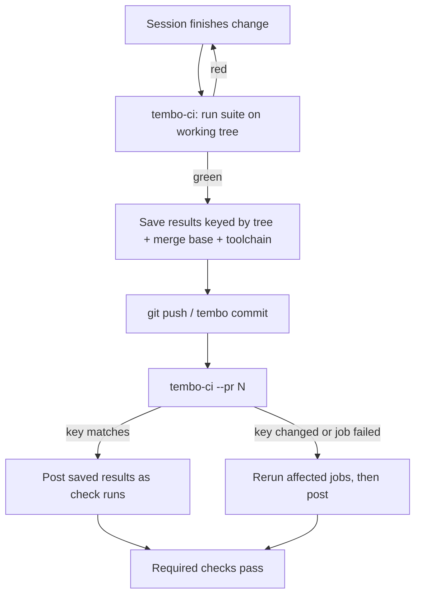

# tembo-session-ci

A portable skill + scripts that let Tembo sessions run a repo's CI themselves and post the results as GitHub check runs on Tembo PRs, while every other PR keeps using GitHub Actions.

## Package contents

- `SKILL.md` – what it does, prerequisites (incl. check-run auth), install steps, verification, rollback, adaptations.
- `code/scripts/ci/` – `job.mjs`, `jobs.mjs` (example jobs), `tembo-ci.mjs`, and `node:test` tests incl. the ci.yml drift test.
- `templates/` – `ci.yml.example`, `jobs.example.mjs`, `AGENTS-snippet.md`.

Self-test: `cd code/scripts/ci && CI_WORKFLOW=../../../templates/ci.yml.example node --test *.test.mjs`

## Run PR CI inside your Tembo sessions

A Tembo coding session already has your code checked out and your dependencies installed, because Tembo snapshots cache both. So instead of pushing a branch and waiting for GitHub Actions to rebuild everything, the session can run your full CI suite once in its sandbox on the finished tree. It pushes only when that run is green, then posts the saved results to the pull request as GitHub check runs.

Running CI in the session this way makes CI after the push effectively free in time and money. Even counting the full cost of the Tembo coding session, a change is about 2x faster end to end and costs only about a third more than coding on "free" laptop compute with unsharded GitHub Actions. It is also cheaper than sharded Actions.

### CI after the push

Baseline: laptop plus unsharded Actions.

| Scenario | CI time | Time vs. baseline | CI cost per push | Cost vs. baseline |
|---|---|---|---|---|
| Local + Actions, unsharded | 11 min | 100% | ~$0.11 (~14 runner-min) | 100% |
| Local + Actions, sharded | 6 min | ~55% | $0.18 (23 runner-min) | ~164% |
| Tembo, jobs one at a time | 3 s | <1% | ~$0 (posting only) | ~0% |
| Tembo, 2 jobs at once (default) | 3 s | <1% | ~$0 (posting only) | ~0% |

In the Tembo rows, the test run before the push counts as part of the coding session (see the next table).

### Full timeline per change, including the coding session

Coding is assumed to take 10 minutes.

| Scenario | 1. Coding | 2. Lint/tests before push | 3. CI after push | Wait for green after coding done | Total time | Time vs. baseline | Cost per change | Cost vs. baseline |
|---|---|---|---|---|---|---|---|---|
| Local + Actions, unsharded | 10 min | 14 min | 11 min | 25 min | 35 min | 100% | ~$0.11 (Actions only) | 100% |
| Local + Actions, sharded | 10 min | 14 min | 6 min | 20 min | 30 min | 86% | $0.18 (Actions only) | ~164% |
| Tembo, jobs one at a time | 10 min | 14 min | 3 s | 14 min | 24 min | 69% | ~$0.21 (24 VM-min) | ~190% |
| Tembo, 2 jobs at once (default) | 10 min | 7 min | 3 s | 7 min | 17 min | 49% | ~$0.15 (17 VM-min) | ~134% |

### Method notes

- Actions is priced at GitHub's $0.008 per runner-minute Linux rate, with each job rounded up to a whole minute. Costs are total billed runner-minutes across all jobs and shards, not wall time.
- Sharded: 6 test shards plus plan, docs and checks jobs. Median of 16 real runs: 6.2 min wall, 23 billed runner-minutes.
- Unsharded is an estimate: the sum of the shard test times plus one job's setup.
- Tembo VM: 8 vCPU / 16 GiB at $0.5304/hour ([tembo.io/pricing](https://tembo.io/pricing)), billed per second.
- Laptop compute and model/token costs are not counted. Coding time is an assumed 10 minutes. Local test time is assumed equal to Tembo running jobs one at a time.
- Tembo posting latency after the push: median about 3-4 s, worst 19 s.

This guide shows how to set that up in any repository. It covers PRs from Tembo sessions and PRs from anywhere else.

## How it works



1. **Before pushing**, the session runs `node scripts/ci/tembo-ci.mjs`. The script works out the git tree of the working directory as it would be committed, runs every CI job against that tree, and saves the results to `.tembo-ci/results/<tree>.json`. That directory is gitignored.
2. **The cache key** is the git tree SHA, the merge base with `main` (your plan or diff base), and the toolchain versions (for example Node and pnpm). The lockfile and CI scripts are inside the tree, so a change to either one means a new key.
3. **After pushing**, the session runs `node scripts/ci/tembo-ci.mjs --pr <n>`. The script reads the PR head, finds the saved results for that tree, and posts one check run per job through the GitHub Checks API. Each check run has the same name as the matching Actions job.
4. **Nothing runs a second time** unless the tree, merge base or toolchain changed, a job failed or timed out, or you pass `--no-cache`. Reused check runs start with `Reused result from <time>, tree <sha>` and keep the start and end times from the original run.
5. **Actions skips only Tembo PRs.** `ci.yml` skips its PR jobs for PRs whose branch starts with `tembo/` and comes from the same repository. Forks can't skip CI by naming a branch that way. Every other PR (Codex, human, forks) runs normal Actions CI. Pushes to `main`, nightly runs, releases and manual runs keep running on Actions.
6. **One set of CI jobs.** Jobs are defined once, in `scripts/ci/jobs.mjs`. Actions and Tembo both run them through `scripts/ci/job.mjs`, and a test fails if the workflow and `jobs.mjs` drift apart. To add a job, edit `jobs.mjs`.

The check runs are posted with the Tembo GitHub App's installation token, which the session already has through its git credential helper. The app can create check runs and commit statuses, so you don't need to add a token.

## Prerequisites

- The Tembo GitHub App is installed on the repository with **Checks: write** permission (add **Commit statuses: write** if you post statuses).
- A Tembo environment or snapshot that has your toolchain and dependencies, plus any services your tests need, such as a local Postgres.
- A CI suite you can start from the command line. Each Actions job should map to an entry in `scripts/ci/jobs.mjs`, run through `scripts/ci/job.mjs`. If your jobs are inline YAML steps, move them into that file first.
- Admin access to the repository, for the branch rules.

## Step-by-step setup

### 1. Gate the PR jobs in your workflow

Put this condition on the root jobs of `ci.yml`. Jobs that `need` a gated job are skipped along with it. The condition skips PR jobs only for same-repo branches starting with `tembo/`.

```yaml
name: CI   # keep the name if other workflows (alerts, etc.) refer to it

on:
  pull_request:
  push:
    branches: [main]
  schedule:
    - cron: '23 6 * * *'
  workflow_dispatch:

jobs:
  plan:
    if: >-
      github.event_name != 'pull_request' || !startsWith(github.head_ref, 'tembo/') || github.event.pull_request.head.repo.full_name != github.repository
    runs-on: ubuntu-latest
    steps: [...]

  lint:
    needs: plan            # skipped when plan is skipped
    steps:
      - run: node scripts/ci/job.mjs lint   # same job definition Tembo runs

  test:
    needs: plan
    steps: [...]

  build:
    needs: plan
    steps: [...]

  checks:                  # the single required gate
    needs: [plan, lint, test, build]
    if: always() && (github.event_name != 'pull_request' || !startsWith(github.head_ref, 'tembo/') || github.event.pull_request.head.repo.full_name != github.repository)
    steps: [...]
```

There is no variable or switch to set: once this change is merged, same-repo `tembo/` PRs skip Actions and every other PR runs in full. To switch back to Actions for everything, revert this `if:` condition in a PR.

### 2. Add the runner script

Create `scripts/ci/tembo-ci.mjs`. The outline below is minimal. In the real setup, `JOBS` is imported from `scripts/ci/jobs.mjs` (the same list Actions uses), and each job runs through `scripts/ci/job.mjs`. The `name` values must match the check names that appear on PRs today.

```js
#!/usr/bin/env node
import { execFileSync, spawn } from 'node:child_process';
import { mkdirSync, readFileSync, writeFileSync, existsSync, copyFileSync, rmSync } from 'node:fs';
import { tmpdir } from 'node:os';
import { join } from 'node:path';

// Names must match the GitHub Actions job names exactly.
const JOBS = [
  { id: 'lint', name: 'lint', cmd: ['pnpm', 'run', 'lint'] },
  { id: 'test', name: 'test',       cmd: ['pnpm', 'test'] },
  { id: 'build', name: 'build',           cmd: ['pnpm', 'build'] },
];
const GATE = 'checks';
const PARALLEL = Number(arg('--jobs') ?? 2);

const git = (args, opts = {}) => execFileSync('git', args, { encoding: 'utf8', ...opts }).trim();
function arg(flag) { const i = process.argv.indexOf(flag); return i > 0 ? process.argv[i + 1] : undefined; }

// 1. Get the tree of the working directory as it would be committed. Use a copy of the
//    index so the real one is left alone. Untracked files that aren't ignored are included.
function workingTree() {
  const index = join(tmpdir(), `tembo-ci-index-${process.pid}`);
  copyFileSync(git(['rev-parse', '--git-path', 'index']), index);
  const env = { ...process.env, GIT_INDEX_FILE: index };
  git(['add', '-A'], { env });
  const tree = git(['write-tree'], { env });
  rmSync(index, { force: true });
  return tree;
}

// 2. Build the cache key.
const toolchain = { node: process.version, pnpm: execFileSync('pnpm', ['-v'], { encoding: 'utf8' }).trim() };
git(['fetch', '--quiet', 'origin', 'main']);

const pr = arg('--pr');
const headSha = pr ? await prHead(pr) : null;           // with --pr, test exactly what was pushed
const tree = pr ? git(['rev-parse', `${headSha}^{tree}`]) : workingTree();
const base = git(['merge-base', pr ? headSha : 'HEAD', 'origin/main']);
const resultsFile = join('.tembo-ci/results', `${tree}.json`);
mkdirSync('.tembo-ci/results', { recursive: true });

const saved = existsSync(resultsFile) && !process.argv.includes('--no-cache')
  ? JSON.parse(readFileSync(resultsFile, 'utf8')) : null;
const sameKey = saved && saved.base === base && JSON.stringify(saved.toolchain) === JSON.stringify(toolchain);
const reusable = id => sameKey && saved.jobs[id]?.conclusion === 'success';

// 3. Run the jobs that can't be reused, PARALLEL at a time, each in its own worktree.
//    Remove secrets from the job env: tokens, production DB URLs, etc.
//    Save { tree, base, toolchain, jobs: { [id]: { conclusion, startedAt, completedAt, summary } } }.

// 4. With --pr, post one check run per job, then the gate last (see payloads below).
//    If anything throws, complete every open check run as failure; on SIGINT, cancelled.
//    Never leave a check run in_progress.
```

To create test commits for a planner that needs a commit SHA instead of a tree, use `git commit-tree` with fixed author, committer and date. The same tree and parent then always produce the same SHA. The commit is never pushed and no branch points to it.

Add the results directory to `.gitignore`:

```gitignore
.tembo-ci/
```

### 3. Post check runs

Send each request to `POST /repos/{owner}/{repo}/check-runs` (and `PATCH /repos/{owner}/{repo}/check-runs/{id}` to finish one) with the installation token. In a session, the token comes from `GITHUB_TOKEN` or `GH_TOKEN` if one is set, and otherwise from `git credential fill` for `github.com`. Never print it.

Fields every payload has:

```json
{ "name": "test", "head_sha": "<PR head sha>", "external_id": "tembo-ci:test",
  "details_url": "<link to the Tembo session>" }
```

**A job running now:**

```json
{ "status": "in_progress", "started_at": "2026-10-31T19:40:00Z",
  "output": { "title": "Running", "summary": "Running in a Tembo session." } }
```

Finish it with a PATCH:

```json
{ "status": "completed", "conclusion": "success", "completed_at": "2026-10-31T19:46:10Z",
  "output": { "title": "Passed in 6m10s", "summary": "commands, exit codes, test counts",
              "text": "on failure: the last lines of the log" } }
```

**A reused result,** created already completed, with the times from the original run:

```json
{ "status": "completed", "conclusion": "success",
  "started_at": "<original start>", "completed_at": "<original end>",
  "output": { "title": "Reused: Passed in 6m10s",
              "summary": "Reused result from 2026-10-31 19:40 UTC, tree 3f2a9c1. Ran on commit abc1234.\n\n..." } }
```

**A job your plan leaves out:**

```json
{ "status": "completed", "conclusion": "skipped", "completed_at": "...",
  "output": { "title": "Skipped", "summary": "Prose-only change; no build needed." } }
```

Post the gate check (`checks` in the examples) last. It passes only if every planned job passed. Keep `summary` and `text` under the API's 65,535-character limit.

### 4. Write agent instructions

Add this to `AGENTS.md`, or whichever instructions file your agents read:

```markdown
## CI in Tembo sessions

PRs from same-repo `tembo/` branches get CI from your session, not GitHub Actions. CI jobs are defined in `scripts/ci/jobs.mjs`; to add a job, edit that file.

1. Finish your change and stage everything (`git add -A`). The pushed tree must be the tested tree.
2. Run `node scripts/ci/tembo-ci.mjs`. If any job fails, fix it and run the script again. **Do not push while it is red.**
3. Push (or `tembo commit`).
4. Run `node scripts/ci/tembo-ci.mjs --pr <number>`. This posts the saved results as check runs.
   Run it again after every push, because check runs belong to a commit.
5. Saved results are reused only for the exact same tree, toolchain and merge base. Any file change reruns everything, and failures always rerun. Use `--no-cache` to force a full rerun.
```

`tembo commit` commits and pushes in one step, so run the script on the finished changes just before it.

### 5. Add it to your Tembo session brief

Add a line like this to the repo's Tembo instructions or task template so every session follows the same steps:

```text
Before pushing, run `node scripts/ci/tembo-ci.mjs` and fix every failure; do not push while it is red.
After the PR exists, run `node scripts/ci/tembo-ci.mjs --pr <PR number>` and confirm all checks are green on the PR.
If the sandbox needs services (e.g. Postgres), start them first.
```

### 6. Size the VM

In our repo, the session runs two jobs at a time on an 8 vCPU VM, and a full run takes about 7 minutes, most of it the database tests. Running more jobs at once on a small VM usually makes the total time longer because the jobs compete for CPU. Add a `--jobs <n>` flag and set a timeout for each job (we use 45 minutes) so a job that hangs ends as `timed_out` and doesn't stall the session.

## Turning it on

There is no variable or switch: turning it on is just merging the workflow change. Before you merge it:

1. Have `jobs.mjs`, `job.mjs`, the script, `.gitignore` and the `AGENTS.md` change in place (in the same PR or merged first).
2. **Check required checks before you merge the workflow gate.** A branch rule that requires `checks` should accept it from either the Tembo app (Tembo PRs) or GitHub Actions (every other PR). Be aware that GitHub can count a skipped Actions `checks` job as passing. Since Actions skips only same-repo `tembo/` branches, those are the PRs to watch: make sure their sessions always post results.
3. Look for existing rulesets that pin required checks to the **GitHub Actions** app only. Tembo's check runs won't satisfy those, so Tembo PRs stay blocked.
4. Merge the workflow change. From then on, same-repo `tembo/` PRs skip Actions.

To switch back to Actions for everything, revert the `if:` condition in a PR. Actions takes over CI for Tembo PRs on their next push after that merges.

## Verifying

- After the workflow change is merged, open a small PR from a Tembo session (`tembo/` branch). In the Actions tab, the PR run should show its jobs as skipped.
- Open a PR from another branch or a fork, including a fork branch named `tembo/...`. Actions should run in full.
- On the PR's **Checks** tab, every job name should appear once, posted by the Tembo app, with the gate last.
- Run `tembo-ci.mjs --pr <n>` a second time without changing anything. Each check should say `Reused result from <time>, tree <sha>`, and the run should finish in seconds.
- Break a test on purpose. The script before the push should fail, and the session should not push.
- Confirm that a merge to `main` still runs the full Actions workflow.

## Fallbacks and caveats

- **Only `tembo/` branches skip Actions.** PRs from people, other agents (such as Codex) and forks run normal Actions CI. A fork can't skip CI by naming its branch `tembo/...`.
- **What gets tested is different from Actions.** Actions tests GitHub's merge commit. This setup tests the pushed tree, diffed against the merge base with the fetched `main`. Pushes to `main` still run in full on Actions, which catches anything that breaks after merging.
- **Check runs belong to a commit.** Post again after every push, including rebases.
- **Remove secrets from the job environment.** Strip the GitHub token, production database URLs and other credentials before running jobs. Tests should use only disposable local services.
- **Clean up on failure.** If the script crashes, complete every open check run as `failure`, and complete them as `cancelled` on an interrupt. A check left `in_progress` blocks the PR.
- **Draft PRs.** The session runs CI on drafts even if your Actions workflow skips them.

## FAQ

**What happens with PRs not created by a Tembo session?**
They run normal GitHub Actions CI. Actions skips its PR jobs only for same-repo PRs whose branch starts with `tembo/`. PRs from people, other agents such as Codex, and forks (even with a `tembo/` branch name) are tested on Actions as usual, using the same job definitions from `scripts/ci/jobs.mjs`.

**How do I turn it off?**
There is no variable to flip. Revert the `if:` condition in `ci.yml` in a PR, and Actions runs for every PR again.

**Does this need a new GitHub token or secret?**
No. Inside a session, the script uses the Tembo GitHub App installation token from the git credential helper. The app needs `checks: write`.

**Why use the same check names as the Actions jobs?**
Branch protection and rulesets match required checks by name. With the same names, your rules apply as they do today. The one setting that changes is the source app.

**Can't a session just post a green check without running anything?**
The script posts only results it recorded for that exact tree. Reused results show the tree and the time they ran, and each check links to the session. The full suite still runs on Actions for every merge to `main`, so a bad result is caught there. If you need stronger guarantees, keep a small set of Actions jobs required on PRs.

**What makes the script run jobs again?**
A different git tree (any file change, including the lockfile and CI scripts, reruns everything), a different merge base with `main`, a different Node or pnpm version, a job that failed or timed out, or `--no-cache`. Reuse avoids testing the same code twice; it never skips testing new code.

**Do caches carry over between jobs?**
Dependencies come from the snapshot and the local package store (`pnpm install --frozen-lockfile --prefer-offline`). The outline doesn't restore compiler or lint caches, and test results are reused only through the tree-keyed results file.

**Where are the logs?**
Each job's log and test output are copied to a local folder (for example `test-results/tembo-ci/`). When a job fails, the end of its log goes into the check run's `text`, so reviewers can see it on the PR.
